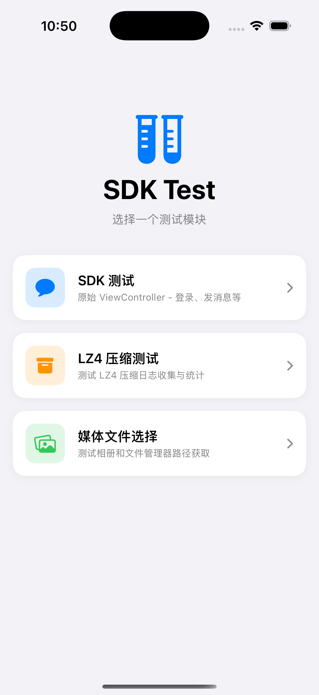

# iOS 应用工具

应用启动后进入模块导航页（`MainNavigationView`），点击卡片进入对应工具。

| 模块 | 源文件 | 说明 |
| --- | --- | --- |
| SDK 测试 | `ViewController.swift` | 原始 UIKit 界面：初始化、登录、收发消息等 |
| LZ4 压缩测试 | `LZ4CompressionTestView.swift` | LZ4 压缩日志收集与统计 |
| 媒体文件选择 | `MediaFilePickerTest.swift` | 测试相册和文件管理器路径获取 |
| 发送图片消息 | `SendImageMessageTest.swift` | 初始化、登录、发送图片消息、退出登录的独立链路测试 |

## SDK 测试

原始的 UIKit 测试界面（Storyboard），用于 SDK 基础功能调试。

- 界面按钮：`Init`（初始化 SDK）、`Login` / `Logout`、`Send`（发文本消息）、`File`（选择文件发送）、`Test`（临时调试入口，内容随调试需求变化，见 `ViewController.testAction`）
- AppKey 写死在 `ViewController.swift` 顶部的 `Appkey` 常量，切换环境时直接改代码
- 支持密码登录，token 过期时自动使用 007 token 重新登录（`TokenBuilder`）

## LZ4 压缩测试



**功能**：统计即时通讯消息的 LZ4 压缩/解压缩效率。通过 `EMLogDelegate` 实时过滤 SDK 日志中的 LZ4 压缩/解压缩记录，流式写入 Markdown 报告。

**界面分区**：

- 账号配置：AppKey、SDK 初始化、用户名/密码登录
- 文件配置：测试数据文件夹路径、目标用户 ID、「准备文件」（流式读取，边读边发，不占内存）
- 发送控制：发送间隔（默认 1000ms）、手动发送 / 重置 / 自动发送 / 停止
- 日志收集：输出目录选择、「开始收集」、「停止并导出」
- 运行日志：界面内实时日志，可清空

**环境支持**：

- **模拟器**：直接输入 Mac 文件夹路径
- **真机**：通过文件夹选择器选择，或手动输入沙盒内路径

**发送方式**：从数据文件逐行读取，将 `payload.bodies[0]` 序列化为 JSON 字符串作为 action，发送 CMD 消息（`EMCmdMessageBody`）给目标用户。

---

### 方法1：本地发送测试

| 步骤 | 操作       | 说明                     |
| :--: | ---------- | ------------------------ |
|  1   | 初始化 SDK | 填写 AppKey 后点击初始化 |
|  2   | 登录       | 输入用户名密码登录       |
|  3   | 准备文件   | 设置测试数据文件夹路径   |
|  4   | 开始收集   | 开启 LZ4 日志收集        |
|  5   | 发送消息   | 单条或自动发送           |
|  6   | 停止收集   | 停止并导出统计报告       |

---

### 方法2：配合 Python 工具

| 步骤 | 操作                                  |
| :--: | ------------------------------------- |
|  1   | 初始化 SDK                            |
|  2   | 登录用户 A                            |
|  3   | 开始收集日志                          |
|  4   | Python 工具：用户 B → 用户 A 发送消息 |
|  5   | 停止并导出，查看统计                  |

> Python 工具详见 `send_message/README.md`

---

### 测试数据格式

JSON 文件（文件夹内所有非隐藏文件都会按行读取），每行一条消息，需包含 `payload.bodies`：

```json
{ "payload": { "bodies": [{ "action": "消息内容" }] } }
```

示例见 `sample/data_sample.json`。

---

### 输出报告

路径：`<输出目录>/output.md`（输出目录默认为应用 Documents，可在界面修改）

内容为 Markdown：每条 LZ4 日志一行（时间、压缩后大小、原始大小、压缩率），末尾附统计汇总（总条数、压缩前/后总大小、平均压缩率）。

## 媒体文件选择

测试相册与文件管理器的文件路径获取，用于验证 SDK 发送文件/图片消息时的路径处理。

- **选择相册图片**：iOS 16+ 使用 `PhotosPicker`（最多 5 张），低版本回退 `UIImagePickerController`；图片数据保存到临时目录后分析路径
- **选择文件**：通过 `UIDocumentPicker` 选择任意文件，使用 `IOSPathResolver` 解析路径类型、存在性、读写权限，并自动向固定会话发送文件消息验证
- 分析结果显示在界面列表中，可一键清除

## 发送图片消息

独立链路测试：初始化 SDK → 登录 → 从相册选择图片发送 → 退出登录。

- AppKey、登录用户名/密码、接收方会话 ID 均为 `SendImageMessageTest.swift` 顶部常量（`kAppKey`、`kLoginUsername`、`kLoginPassword`、`kReceiverId`），使用前直接在代码中修改；默认密码为空，未填写时点击登录会在日志中提示
- 接口调用参考 `ViewController.swift`：`EMOptions` 初始化（关闭自动登录）、`login(withUsername:password:)`（如需 token 登录可改为 `login(withUsername:token:)`）、`logout(false:)`
- 图片选择参考 `MediaFilePickerTest.swift`：iOS 16+ 使用 `PhotosPicker`，低版本回退 `UIImagePickerController`；选中后保存到临时目录，用 `EMImageMessageBody(localPath:)` 构造图片消息发送
- 界面显示初始化/登录状态和实时日志（含上传进度、发送结果 messageId），按钮按链路顺序（1→4）依次置灰/可用

## 其他源文件

以下文件编译进 App 但不对应独立界面，为辅助/调试代码：

| 文件 | 说明 |
| --- | --- |
| `test_remove_group_member.swift` | 群成员移除场景的测试辅助，含消息监听记录 |
| `VPNChecker.swift` | VPN / 端口检测调试工具（分析文档见 `../docs/`） |
| `TokenBuilder.h/.mm`、`007token/`、`openssl_1.1.1/` | 007 token 生成 |
| `IOSPathResolver.h/.m` | 文件路径解析，供媒体文件选择模块使用 |
