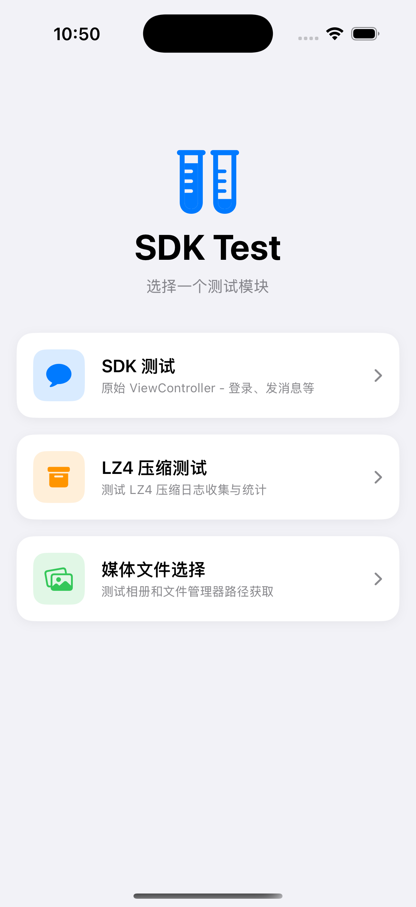

# iOS 应用工具

应用启动后进入模块导航页（`MainNavigationView`），点击卡片进入对应工具。

| 模块 | 源文件 | 说明 |
| --- | --- | --- |
| 登录与初始化 | `SDKLoginView.swift` | 可选初始化参数、Token 登录及供新页面复用的共享状态 |
| 多 bodies 消息 | `MultiBodiesMessageTest.swift` | 自由组合文本、图片、文件，验证收发、下载回调和本地读写 |
| SDK 测试 | `ViewController.swift` | 原始 UIKit 界面：初始化、登录、收发消息等 |
| LZ4 压缩测试 | `LZ4CompressionTestView.swift` | LZ4 压缩日志收集与统计 |
| 媒体文件选择 | `MediaFilePickerTest.swift` | 测试相册和文件管理器路径获取 |
| 发送图片消息 | `SendImageMessageTest.swift` | 初始化、登录、发送图片消息、退出登录的独立链路测试 |
| 用户 Token | `EasemobUserTokenView.swift` | 通过 Bearer Token 获取用户登录 Token |
| 群组多设备事件 | `GroupMultiDeviceEventTest.swift` | 验证 HIM-23838 的群组多设备事件 30/31/32/33 |
| API 调用 | `ApiTestViews.swift`、`ApiTestRegistry.swift` | 注册表驱动的指定 API 调用：搜索、编辑 JSON 参数、查看统一格式结果 |

## 登录与初始化、多 bodies 消息

这两个新页面共享 `SDKLoginState.shared`。登录及初始化只在「登录与初始化」页面操作；原有测试页面未改造。Token 获取复用 `EasemobUserTokenForm`，也可以直接粘贴用户 Token。

1. 首页进入「登录与初始化」，填写 AppKey、用户名及 Token。可选初始化参数包含控制台日志、HTTPS、自动传输附件、自动下载缩略图/语音、自动加载会话、同步会话/群组/联系人。控制台日志与同步会话/群组/联系人初始为「启用」，其余各项初始为「默认」；只对明确选为启用/禁用的项目覆盖 `EMOptions`；同步项对应 `EMOptions.dataSyncType` 位掩码，「默认」按 SDK 默认值取值（会话开、群组/联系人关），任一同步项改动后整体覆盖。首次初始化后修改配置需重启 App。
2. 初始化、登录后进入「多 bodies 消息」。也可以从测试页打开登录页，登录后点「返回测试」。新页面自动读取共享状态。
3. 填写目标 ID，选择单聊、群聊或聊天室。群聊/聊天室使用已加入的目标。
4. 文本可逐段添加；照片、图片文件及普通文件均可多选，也可每行粘贴一个设备可访问的路径。文件选择沿用系统 `fileImporter`，照片沿用 `PhotosPicker`；导入后才发送，不自动拆成多条消息。外部文件在安全访问期间复制到 App 的 `Documents/MultiBodiesImports/`，大文件通过文件复制导入，不整块读入内存。
5. 在列表中查看 body 下标、内容、路径及字节数，可删除或上下移动。一个条目是单 body，多个条目是一条复合消息；发送顺序以列表为准。单 body 可切换旧/新发送 API，多 body 使用新 API。界面不硬编码 50 的限制，以 SDK 当前 dnsconfig 为准。
6. 日志显示发送结果与上传进度；接收列表显示完整 bodies。图片 body 可通过「图片发送原图」开关选择发送原图或压缩大图（GIF 始终按原图）。选中消息后按整条消息下载原附件、缩略图或大图：复合消息内所有适用 body 按顺序处理、整次请求回调一次，完成后逐 body 核对状态、路径及文件是否落盘（存在性与字节数）。
7. 使用「保存当前消息」「从本地读取」检查数量、顺序及状态。最近消息 ID 会保存，重启后登录同一账号再按该 ID 读取；密码和 Token 不持久化。

双设备验证：两台设备使用同一 AppKey、不同账号登录。接收端停留在「登录与初始化」即可；发送端进入「多 bodies 消息」，目标填写接收端账号。接收端的「登录与接收日志」会记录消息 ID、收发方、会话类型、body 数量及按原始下标排列的文本或附件信息，并记录附件自动下载状态变化。共享接收监听不随页面退出而移除；需要手动下载时，再进入「多 bodies 消息」按日志中的消息 ID 从本地读取。

两个新页面的日志区固定为 240 点高，区域内滚动。页面日志同时输出到 Xcode 控制台，前缀分别为 `[SDKDemo]`（登录、接收及附件状态）和 `[MultiBodies]`（测试页操作及进度）；不依赖 SDK 的「控制台日志」开关，该开关仍只控制 SDK 自身日志。

建议先测：一段文本、一个文件（旧 API 和新 API）、两段不同文本、两张不同图片、多个文件、文本+图片+文件、调整顺序后发送。附件大小覆盖小于 2MB、超过 2MB 但未到实际分片阈值、超过分片阈值三档，结合 SDK 日志确认实际路径。服务端下发 `multi-bodies.max_count=20` 时比较 20/21 个 bodies；无有效下发时比较默认 50/51。

编译设备 Debug 产物（不签名；运行时使用本机 Xcode 的开发签名）：

```sh
xcodebuild -workspace sdkTest.xcworkspace -scheme sdkTest \
  -configuration Debug -sdk iphoneos -destination 'generic/platform=iOS' \
  BUILD_DIR="$PWD/build" BUILD_ROOT="$PWD/build" ARCHS=arm64 VALID_ARCHS=arm64 \
  SWIFT_PRECOMPILE_BRIDGING_HEADER=NO ENABLE_BITCODE=NO CODE_SIGNING_ALLOWED=NO build
```

workspace 直接引用兄弟目录的 Core/iOS SDK 工程。demo 需要 SDK 的 `EMBridgeHeader.swift`（原页面使用 `swiftBody`），不要套用排除该文件的 SDK 单独构建参数。本轮仅编译，实际收发和服务器配置下发由用户手动验证。

## SDK 测试

原始的 UIKit 测试界面（Storyboard），用于 SDK 基础功能调试。

- 界面按钮：`Init`（初始化 SDK）、`Login` / `Logout`、`Send`（发文本消息）、`File`（选择文件发送）、`Test`（临时调试入口，内容随调试需求变化，见 `ViewController.testAction`）
- AppKey 写死在 `ViewController.swift` 顶部的 `Appkey` 常量，切换环境时直接改代码
- 支持密码登录，token 过期时自动使用 007 token 重新登录（`TokenBuilder`）

## LZ4 压缩测试



**功能**：统计即时通讯消息的 LZ4 压缩/解压缩效率。通过 `EMLogDelegate` 实时过滤 SDK 日志中的 LZ4 压缩/解压缩记录，流式写入 Markdown 报告。

**界面分区**：

- 账号配置：AppKey、SDK 初始化、用户名/密码登录
- 文件配置：测试数据文件夹路径、目标用户 ID、「准备文件」（流式读取，边读边发，不占内存）
- 发送控制：发送间隔（默认 1000ms）、手动发送 / 重置 / 自动发送 / 停止
- 日志收集：输出目录选择、「开始收集」、「停止并导出」
- 运行日志：界面内实时日志，可清空

**环境支持**：

- **模拟器**：直接输入 Mac 文件夹路径
- **真机**：通过文件夹选择器选择，或手动输入沙盒内路径

**发送方式**：从数据文件逐行读取，将 `payload.bodies[0]` 序列化为 JSON 字符串作为 action，发送 CMD 消息（`EMCmdMessageBody`）给目标用户。

---

### 方法1：本地发送测试

| 步骤 | 操作       | 说明                     |
| :--: | ---------- | ------------------------ |
|  1   | 初始化 SDK | 填写 AppKey 后点击初始化 |
|  2   | 登录       | 输入用户名密码登录       |
|  3   | 准备文件   | 设置测试数据文件夹路径   |
|  4   | 开始收集   | 开启 LZ4 日志收集        |
|  5   | 发送消息   | 单条或自动发送           |
|  6   | 停止收集   | 停止并导出统计报告       |

---

### 方法2：配合 Python 工具

| 步骤 | 操作                                  |
| :--: | ------------------------------------- |
|  1   | 初始化 SDK                            |
|  2   | 登录用户 A                            |
|  3   | 开始收集日志                          |
|  4   | Python 工具：用户 B → 用户 A 发送消息 |
|  5   | 停止并导出，查看统计                  |

> Python 工具详见 `send_message/README.md`

---

### 测试数据格式

JSON 文件（文件夹内所有非隐藏文件都会按行读取），每行一条消息，需包含 `payload.bodies`：

```json
{ "payload": { "bodies": [{ "action": "消息内容" }] } }
```

示例见 `sample/data_sample.json`。

---

### 输出报告

路径：`<输出目录>/output.md`（输出目录默认为应用 Documents，可在界面修改）

内容为 Markdown：每条 LZ4 日志一行（时间、压缩后大小、原始大小、压缩率），末尾附统计汇总（总条数、压缩前/后总大小、平均压缩率）。

## 媒体文件选择

测试相册与文件管理器的文件路径获取，用于验证 SDK 发送文件/图片消息时的路径处理。

- **选择相册图片**：iOS 16+ 使用 `PhotosPicker`（最多 5 张），低版本回退 `UIImagePickerController`；图片数据保存到临时目录后分析路径
- **选择文件**：通过 `UIDocumentPicker` 选择任意文件，使用 `IOSPathResolver` 解析路径类型、存在性、读写权限，并自动向固定会话发送文件消息验证
- 分析结果显示在界面列表中，可一键清除

## 发送图片消息

独立链路测试：初始化 SDK → 登录 → 从相册选择图片发送 → 退出登录。

- AppKey、登录用户名/密码、接收方会话 ID 均为 `SendImageMessageTest.swift` 顶部常量（`kAppKey`、`kLoginUsername`、`kLoginPassword`、`kReceiverId`），使用前直接在代码中修改；默认密码为空，未填写时点击登录会在日志中提示
- 接口调用参考 `ViewController.swift`：`EMOptions` 初始化（关闭自动登录）、`login(withUsername:password:)`（如需 token 登录可改为 `login(withUsername:token:)`）、`logout(false:)`
- 图片选择参考 `MediaFilePickerTest.swift`：iOS 16+ 使用 `PhotosPicker`，低版本回退 `UIImagePickerController`；选中后保存到临时目录，用 `EMImageMessageBody(localPath:)` 构造图片消息发送
- 界面显示初始化/登录状态和实时日志（含上传进度、发送结果 messageId），按钮按链路顺序（1→4）依次置灰/可用

## 用户 Token

首页的「用户 Token」是独立页面，支持输入 Base URL、AppKey、用户名、密码和 Bearer Token，并复制接口返回的用户 Token。Token 能力分为两层：

- `EasemobUserTokenService` 是无 UI 的 HTTP 工具，业务代码可以直接调用。
- `EasemobUserTokenForm` 是可嵌入其他 `Form` 的页面组件，状态由 `EasemobUserTokenViewModel` 管理。其他页面可以共享该 ViewModel，并直接使用其中的 `accessToken` 登录。

无 UI 调用示例：

```swift
let request = EasemobUserTokenRequest(
    baseURL: "https://ngi-a1.easemob.com",
    appKey: "org#app",
    username: "user1",
    password: "password",
    bearerToken: "app bearer token"
)
let token = try await EasemobUserTokenService.shared.fetchToken(request).accessToken
```

页面组件调用示例：

```swift
@StateObject private var tokenViewModel = EasemobUserTokenViewModel()

var body: some View {
    Form {
        EasemobUserTokenForm(viewModel: tokenViewModel) { token in
            // 使用 token 登录
        }
    }
}

func login() {
    Task {
        // 已手动填写 accessToken 时直接返回，否则自动发起 HTTP 请求。
        let token = try await tokenViewModel.resolveAccessToken()
        // 将 token 交给 SDK 登录。
    }
}
```

密码、Bearer Token 和用户 Token 只保存在当前页面内存中，不会写入日志或持久化。

## 群组多设备事件

使用同一账号在两台 iOS 设备登录。设备 1 负责执行群操作，设备 2 负责监听同账号的多设备事件；用户 2 是被加入和移出白名单的群成员。

### 前置条件

- 在两台真机或两个模拟器安装同一测试 App，并确保使用包含 HIM-23838 修复的 `HyphenateChat.framework`。
- 准备两个已存在的用户：用户 1 用于两台设备同时登录，用户 2 作为群成员和白名单操作目标。
- 两台设备都打开首页的「群组多设备事件」。

群组多设备事件页面直接复用 `EasemobUserTokenForm`。可以在「用户 Token（可手动粘贴）」中填入已有 Token，也可以先点击「获取用户 Token」；如果 Token 为空，点击「登录」时会自动通过同一个 ViewModel 请求 Token。密码、Bearer Token 和用户 Token 只保存在当前页面内存中，不会写入日志或持久化。

### 操作步骤

1. 在设备 1 选择「操作端」，填写 Base URL、AppKey、用户 1、密码、Bearer Token 和用户 2；依次点击「初始化」和「登录」。
2. 在设备 2 选择「观察端」，填写相同配置和同一个用户 1；依次点击「初始化」和「登录」。确认两台设备的 SDK、登录和连接状态均为绿色。也可以提前获取用户 1 的 Token，并在两台设备的「用户 Token（可选）」中粘贴同一个 Token。
3. 在设备 1 点击「创建测试群」。创建成功后，复制页面群 ID 输入框中的群 ID。
4. 在设备 2 的群 ID 输入框粘贴该群 ID，然后点击「观察 30/31/32/33」。此时观察端开始等待事件 30，单个事件的超时时间为 35 秒。
5. 立即回到设备 1，点击「运行 30/31/32/33」。操作端会自动依次执行添加白名单、移除白名单、全员禁言和解除全员禁言，并在每一步后从服务端回读状态。
6. 等待两台设备完成。设备 1 应显示 `Operator PASS`；设备 2 应显示 `Observer PASS`，并依次记录事件 30、31、32、33。
7. 在设备 1 点击「销毁测试群」，确认成功后两台设备分别退出登录。

不要在设备 2 开始观察之前运行设备 1 的操作。观察端会校验群 ID、事件顺序、35 秒超时，以及事件 30/31 中的用户 2；任一条件不满足都会显示 `FAIL`。

## API 调用

注册表驱动的通用 API 测试页（实现思路参考 Flutter example 的 registry 模式）：不为每个 API 写界面，而是在 `ApiTestRegistry.swift` 中手工注册 `ApiEntry`（名称、分组、说明、参数 JSON 模板、invoke 闭包），页面完全由注册表驱动。初始化与登录复用「登录与初始化」页面的共享状态，本页面只读显示，请先在该页面完成初始化和登录。

1. 首页进入「API 调用」，列表展示全部已注册 API，可按名称或分组关键字过滤（大小写不敏感）。
2. 点击某条 API 弹出调用页：查看参数说明、编辑 JSON 参数（预填必填字段模板）、点击「调用」。
3. 结果为统一格式的格式化 JSON，可选择、复制；同时输出到 Xcode 控制台，前缀 `[APITester]`。成功为 `{"success": true, "data": ...}`，失败为 `{"success": false, "error": {"code": ..., "message": ...}}`，`error.code` 即 `EMError.code`。

当前已注册 API（名称按 `分组.方法` 命名，说明中标注对应的 ObjC 接口）：

| 注册名 | 对应接口 | 说明 |
| --- | --- | --- |
| `ChatManager.sendMessage` | `-[EMChatManager sendMessage:progress:completion:]` | 发送文本消息，chatType：0 单聊/1 群聊/2 聊天室 |
| `ChatManager.getAllConversations` | `-[EMChatManager getAllConversations]` | 本地全部会话，不创建会话，参数 `{}` |
| `ContactManager.addContact` | `-[IEMContactManager addContact:message:completion:]` | 发送好友邀请，username 必填，message 可选 |
| `ContactManager.deleteContact` | `-[IEMContactManager deleteContact:isDeleteConversation:completion:]` | 删除联系人，可指定删除或保留相关会话和消息 |
| `ContactManager.getAllContacts` | `-[EMContactManager getAllContacts]` | 本地全部联系人（userId/remark/addTimestamp） |
| `GroupManager.getJoinedGroups` | `-[EMGroupManager getJoinedGroups]` | 本地缓存的已加入群组 |
| `ChatManager.fetchMessagesFromServer` | `-[EMChatManager fetchMessagesFromServerBy:conversationType:cursor:pageSize:option:completion:]` | 分页拉取服务器历史消息（其他端常叫 asyncFetchHistoryMessages），返回 `{"cursor", "list"}` |

手动复验删除联系人：登录后先调用 `ChatManager.getAllConversations`（参数 `{}`）确认目标会话存在。再调用 `ContactManager.deleteContact`，参数为 `{"username":"目标联系人ID","isDeleteConversation":true}`。`true` 表示删除会话和消息，对应 Android 的 `keepConversation=false`；`false` 表示保留，该布尔参数必填。删除成功后再次获取会话列表，预期 `data` 中没有目标 `conversationId`；没有其他会话时为 `[]`。查询不会创建会话。结果可复制，并输出到 Xcode 控制台的 `[APITester]` 日志。

手动复验联系人列表：

1. 调用 `ContactManager.addContact`，参数 `{"username":"zuoyu02","message":""}`。`message` 可省略、传 `null` 或空字符串；成功表示邀请请求成功，需要对方同意或自动接受。
2. 调用 `ContactManager.getAllContacts`（`{}`），先确认 `data` 中存在 `userId=zuoyu02`，再调用 `deleteContact`。
3. 删除成功后立即查询一次本地联系人列表并保留结果；服务端 `ROSTER REMOVE` 通知处理后会触发 `friendshipDidRemoveByUser`，此后再次查询预期不再包含 `zuoyu02`。通知可能晚于删除 API 成功返回；若暂未收到通知，稍后重查并保留完整 SDK 日志。
4. `isDeleteConversation` 只控制会话和消息是否保留，不影响联系人应被删除的预期。

新增 API 时在 `apiRegistry` 数组追加一条 `ApiEntry` 即可；返回值若是 SDK 模型，需在 `toJsonSafe` 中补充对应的 JSON 转换。注意 iOS 与 Flutter 的枚举值不一致（如消息 body 类型 iOS 从 1 开始、Flutter 从 0 开始），编写跨端脚本时以各端说明为准。

## 其他源文件

以下文件编译进 App 但不对应独立界面，为辅助/调试代码：

| 文件 | 说明 |
| --- | --- |
| `test_remove_group_member.swift` | 群成员移除场景的测试辅助，含消息监听记录 |
| `VPNChecker.swift` | VPN / 端口检测调试工具（分析文档见 `../docs/`） |
| `TokenBuilder.h/.mm`、`007token/`、`openssl_1.1.1/` | 007 token 生成 |
| `IOSPathResolver.h/.m` | 文件路径解析，供媒体文件选择模块使用 |
